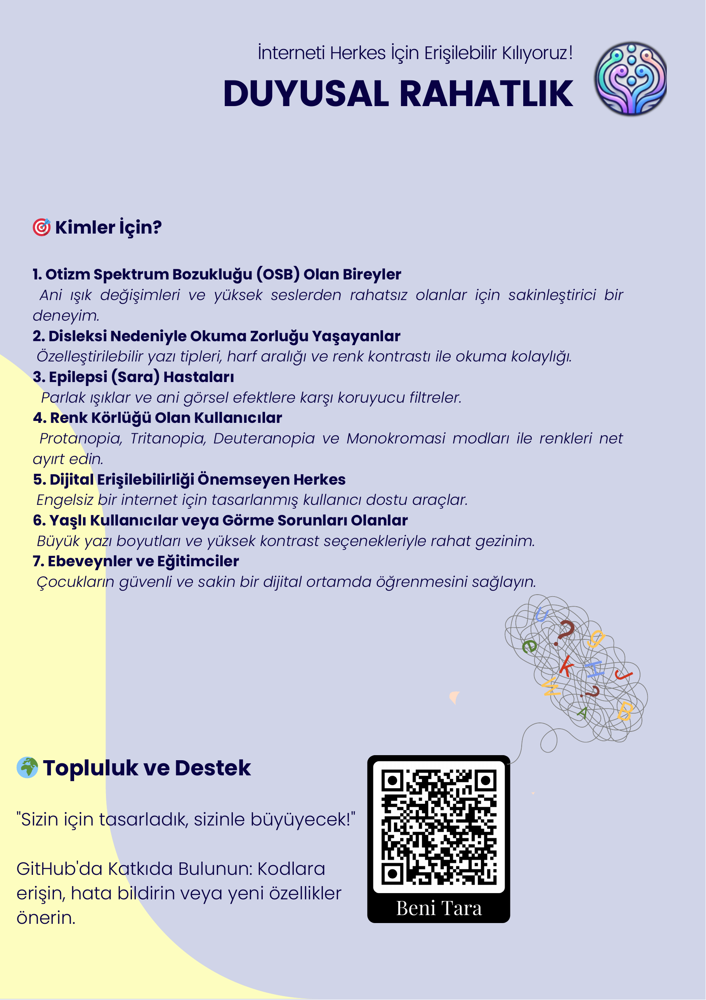

English | [Türkçe](README.tr.md)

[](https://github.com/oguzhanbilir/duyusalRahatlik/actions/workflows/check.yml)

<p align="center"></p>

# Sensory Comfort

A browser extension for Chromium-based browsers (Chrome, Edge, Opera, Brave) that makes web pages easier on the eyes and less overwhelming. It was built with people with sensory sensitivity and low vision in mind, following WCAG 2.1 guidelines.

**TÜBİTAK 2204-B** · 2nd place, regional exhibition (2024)

Project page: https://oguzhanbilir.github.io/duyusalRahatlik/

## Features

- Change colour contrast
- Adjust text size
- Turn off page animations
- Adjust brightness
- Increase letter and line spacing
- Focus mode

Settings are saved and applied to every page you open.

## Install

```bash
git clone https://github.com/oguzhanbilir/duyusalRahatlik.git
```

1. Open `chrome://extensions/` (`edge://extensions/` on Edge, `opera://extensions/` on Opera)
2. Turn on Developer mode
3. Click "Load unpacked" and select the cloned folder

Click the extension icon in the toolbar to open the settings. `test.html` is a sample page for trying the options, and `gorseller/` holds the test images it uses (such as Ishihara plates).

## Files

| File | Purpose |
|------|---------|
| `manifest.json` | Extension manifest |
| `popup.html`, `popup.js` | Settings panel |
| `content.js` | Applies the settings to the page |
| `style.css` | Styles injected into pages |

## Results

From the exhibition write-up: the extension was tried on several Chromium browsers and sites. Measured page metrics with it enabled were LCP 0.15 s, CLS 0.06 and INP 8 ms. Profile settings survive a browser restart.

<p align="center"></p>

The version history, including the early "ÇakaSoftEx" prototypes, is in [CHANGELOG.md](CHANGELOG.md).

## Credits

Student research project. Advisor and developer: Oğuzhan Bilir.
